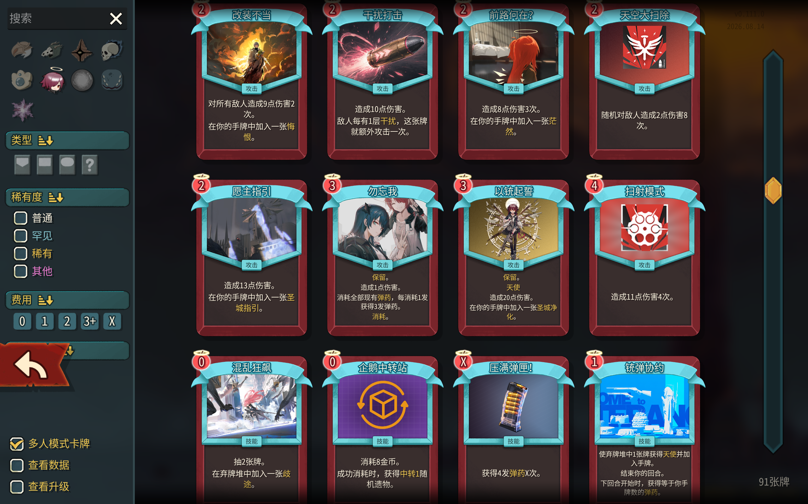

# 能天使 · Exusiai

> 子弹上膛，准备万全★

企鹅物流资深员工、苹果派物流老板能天使，前来《Slay the Spire 2》的高塔拓展业务（真的吗）。这是一个包含简体中文与英文的非官方、非盈利角色 Mod。


## 内容与玩法

- **弹药与过载**：弹药为攻击提供额外伤害；弹药越多，增伤越高。达到上限后进入过载，攻击力提升且不再扣除弹药。
- **天使**：赋予卡牌保留与一次免费打出，配合三张圣城衍生牌组织连招。
- **企鹅物流**：通过快递暂时寄出遗物换取收益，再用中转调度临时遗物；八位企鹅物流成员会以物流卡登场。
- **干扰与沉默**：降低敌人的攻击，并使其被动能力暂时失效。

当前本地构建注册 105 张卡牌（91 张角色卡、12 张衍生牌、2 张诅咒）；另有 9 件角色遗物、6 瓶药水、拉特兰与企鹅物流两位先古之民及其 20 件遗物，以及能天使与新约能天使两组角色骨骼、共 6 套时装。

| 角色与外观 | 战斗与卡牌 |
| --- | --- |
|  |  |

## 安装与兼容

本地源码目前面向游戏测试分支 v0.113.0，前置依赖 [RitsuLib 0.6.11](https://steamcommunity.com/sharedfiles/filedetails/?id=3747602295)。[工坊页面](https://steamcommunity.com/sharedfiles/filedetails/?id=3801483321)中的实际上传版本可能较旧；多人游戏请保持游戏、Mod、依赖版本以及内容 Mod 加载顺序一致。

GitHub 的 **Download ZIP 是源码，不是可直接安装的 Mod 包**。若使用维护者提供的手动安装包，请将 `AK_Exusiai.dll`、`AK_Exusiai.pck` 和 `AK_Exusiai.json` 放入游戏的 `mods/AK_Exusiai/`，并安装匹配版本的 RitsuLib。

## 反馈

请通过 [GitHub Issues](https://github.com/Jimmyzzt/AK_Exusiai/issues)、工坊 BUG 反馈帖或交流群说明游戏与 Mod 版本、相关卡牌及升级状态、单人/多人和复现步骤。交流群：QQ 1080295067。

遇到异常时，请附发生问题那次运行的 `godot.log`；多人不同步请同时提供对应的 `ritsulib_state_divergence_*.zip`。游戏控制台输入 `open logs` 可以打开日志目录。

## 开发

项目使用 C#、.NET 9、Godot 4.5.1 Mono 与 RitsuLib。构建与本机环境说明保存在 [开发文档](docs/archive/DEVELOPMENT.md)，当前实现和发布前待办见 [进度记录](docs/PROGRESS.md)，卡图及卡牌特效工具见 [制作工具](tools/README.md)。较大的机制调整建议先讨论设计。

```powershell
dotnet build .\AK_Exusiai.csproj
```

完整构建前请退出游戏。仓库目前没有统一代码许可证；源码公开不代表项目内全部代码和素材获得任意用途的授权。

## 致谢

感谢 Mega Crit、《明日方舟》的创作者、PRTS、RitsuLib 与社区工具维护者，感谢妮芙 Mod 作者提供的参考和帮助，也感谢参与测试和反馈的玩家。

角色、美术、音效与第三方工具各有其来源和权利归属，详见 [素材与致谢](docs/archive/CREDITS.md)。

---

## English

Exusiai of Penguin Logistics is bringing Ammo, Overload, angelic blessings, and a whole logistics crew to the Spire. The current local build registers 105 cards, 9 character relics, 6 potions, two Ancients with 20 relics, six appearances across Exusiai and Exusiai the New Covenant, and both Simplified Chinese and English localization.

RitsuLib 0.6.11 is required for the local beta v0.113.0 build. Check the [Workshop page](https://steamcommunity.com/sharedfiles/filedetails/?id=3801483321) for the version actually uploaded. See the [English Workshop description](docs/workshop/description.en.md) for the full feature list and feedback instructions.
